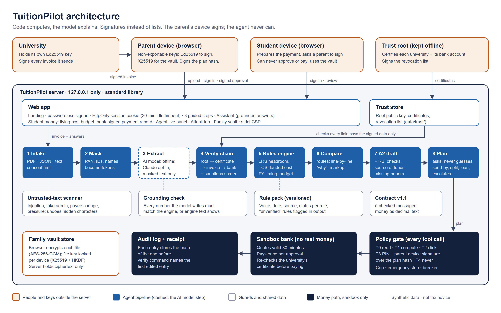

# TuitionPilot: technical documentation

Version 0.5, 19 Oct 2026. Official deliverable: system architecture, core algorithm, security design.
Status marks: **Built** = in the repo with tests; **Planned** = designed, not built yet.

**At a glance (19 Oct 2026):** 248 tests pass · 27 of 27 scenarios pass · 16 of 16 attacks stopped in the attack lab · the demo audit chain (153 entries) verifies · standard library only, nothing to install.

> Synthetic data only. No real money. Not tax advice. Tax rules marked "unverified" are flagged in every output.

## 1. What it does

An Indian family must pay a university abroad. Today they work out on their own:
- how much of the yearly Liberalised Remittance Scheme (LRS) limit they have left;
- how much tax collected at source (TCS) the bank will add;
- which bank or provider is really cheapest once the hidden exchange-rate markup is counted;
- which papers the bank wants.

TuitionPilot is an agent that reads the invoice, checks the university's digital signature, does those calculations, explains them line by line,
drafts the A2-style form, and pays only inside a simulated bank after the parent enters a PIN and the parent's own device signs the exact plan.

**Design rule: code computes, the model explains.** Every number with a right answer (tax, cost, limits) comes from
plain, tested Python. The language model only reads documents and puts the engine's results into words, and
even those words are checked (see 4.3).

## 2. Architecture



Source: [architecture.svg](architecture.svg). How to read it:
- **Orange (outside the server):** the university, the parent's and student's browsers, and the trust root. Every private key lives here, never on the server.
- **Blue (agent pipeline):** the steps from invoice to plan. The dashed box is the only step that uses an AI model, and it sees masked text only.
- **White (guards and shared data):** the scanner, the grounding check, the rule pack and the message contract.
- **Navy (money path, sandbox only):** policy gate → sandbox bank → audit log and receipt.

| Stage | Module | Owner | Status |
|---|---|---|---|
| 1 Intake, consent | `app/static/` UI, `agent/agent.py`, `agent/pdf.py` (PDF text, standard library) | Nishanth | Built |
| 2 Mask | `security/masking.py` | Chandan | Built |
| 3 Extract | `agent/model.py` (offline deterministic adapter; a hosted model can plug in) | Nishanth | Built |
| 4 Payee check | `security/pki.py` (trust root → certificate → signed invoice), `security/ed25519.py` | Both | Built |
| 5 Rules | `rules/engine.py`, `rulepack/india_lrs_tcs.json` | Chandan | Built |
| 6 Compare + explain | `rules/engine.py: compare_routes()`, `rules/explain.py` | Chandan | Built |
| Form | `forms/a2.py`, `corridors/*.json` | Chandan | Built |
| Untrusted-text scan | `security/guard.py: scan()` | Chandan | Built |
| Grounding check | `security/grounding.py` | Chandan | Built |
| Messages between parts | `contract/__init__.py`, `docs/CONTRACT.md` | Both | Built |
| 7 Plan, questions, escalation | `agent/agent.py` | Nishanth | Built |
| 8 Policy gate | `app/policy.py` (tiers, PIN, cap, emergency stop, circuit breaker) | Nishanth | Built |
| 9 Approve | `agent/agent.py: approve()`: PIN + parent device signature over the plan hash | Both | Built |
| 10 Execute | `app/sandbox.py` (quotes, ledger, idempotent payments) | Nishanth | Built |
| 11 Record | `app/audit.py` (hash chain, verify command), decision receipt | Nishanth | Built |
| 12 Track | Timeline in the UI | Nishanth | Built |

Parts talk only through the five contract messages (`invoice`, `quote`, `rule_result`, `plan`, `approval`).
Every message is checked with `contract.validate()` before it is used. Money travels as a decimal string, never a float.

Standard library only (Python 3.10+). No third-party packages so far.

## 3. Core algorithms

All money uses Python `Decimal`. Rupee amounts are rounded to paise (half-up); TCS is rounded to the whole rupee.

### 3.1 Rule pack
`rulepack/india_lrs_tcs.json` holds every rate and threshold with:
- `value`
- `effective_from`
- `status` (`verified`, `secondary-source` or `unverified`); `verified` only with a primary government source (enforced by `tests/test_rules.py`)
- `source`
- `check_against`: the primary source to confirm against
- the pack `version`

The engine never hard-codes a rate. Every result carries a **trace**: the rule id, pack version, effective date, status and source of each rule it used. Any rule marked `unverified` is listed in `needs_verification`, and the user interface must show it as unverified.

**Compliance checks** (`rules/engine.py: compliance_checks`, added 19 Oct): five pass/fail checks for each payment, each with its rule trace, shown on the Documents & A2 step and listed on the receipt:
purpose is studies abroad (`lrs_purpose_studies_abroad_permitted`), within the LRS limit (`lrs_annual_cap_usd`; above it, `lrs_studies_above_cap_on_institution_estimate` says only the bank can allow more on the university's estimate), PAN provided (`lrs_pan_mandatory`), Form A2 to the bank (`lrs_form_a2_required`) and the TCS rule applied (self-funded or loan). The four new RBI rules were checked on 19 Oct 2026 against the RBI Master Direction on LRS (updated 6 Sep 2024), paras 7, 7(h), 15 and 16, and are marked `verified`.

If a calculation is asked for a date before a rule took effect (for example, the 2% education rate before 1 April 2026), the engine refuses instead of guessing.

### 3.2 TCS on an education remittance
```
cumulative = earlier LRS remittances this financial year (all purposes) + this payment
taxable    = max(0, cumulative - max(earlier, threshold))      self-funded
taxable    = 0                                                 loan from a notified institution
TCS        = round_to_rupee(taxable x rate)
rate       = education self-funded rate, or the no-PAN rate if PAN is missing
```
`max(earlier, threshold)` means:
- if earlier payments already passed the threshold, the whole new payment is taxed;
- otherwise, only the part above the threshold is taxed.

The financial year runs from April to March (`financial_year()`).

`YTDTracker` adds up earlier remittances per person, for all purposes, within the same financial year. It ignores earlier years and future-dated entries.

### 3.3 LRS headroom
```
headroom_before = annual cap (USD) - earlier USD this year
headroom_after  = headroom_before - this payment (USD)
within_cap      = headroom_after >= 0       (false -> flag and stop)
```

### 3.4 Landed cost and route ranking
For each route (provider rate, fee, GST rate on the fee, correspondent charges):
```
remitted = foreign amount x provider rate
gst      = fee x GST rate (from the provider's fee schedule)
total    = remitted + fee + gst + correspondent + TCS on remitted
markup   = (provider rate - mid-market rate) x foreign amount      (the hidden cost)
```
Routes are ranked by `total`, cheapest first, and each route records its saving against the next one.

`rules/explain.py` turns the result into plain-English lines that code writes:
- one line per cost component;
- a summary ("Cheapest: Provider B at Rs 18,23,080, Rs 4,620 less than Provider A");
- a "why" breakdown (exchange rate, fee, GST, TCS) whose amounts add up exactly to the saving;
- a hidden-markup explainer.

Each line lists the rule ids it relied on and which of them are unverified.

### 3.5 A2-style draft and checklist
`forms/a2.py` fills an A2-shaped draft from:
- the invoice;
- the remitter's answers;
- the chosen route's numbers;
- the corridor file.

It always says it is a draft and not an official bank form.

The draft has three possible outcomes:
- **Ready:** all required fields are present.
- **Needs information:** a required field is missing. It becomes a question (for example the due date in scenario A9, or the PAN in A6), and the draft never guesses.
- **Blocked:** the invoice's signature chain fails, or the currency does not match the corridor.

The missing-documents checklist is taken from the corridor. For example, the visa document is the I-20 for the USA and the CAS for the UK, and the loan letter is only asked for when the payment is loan-funded.

### 3.6 Corridors as config
`corridors/in_us.json` and `corridors/in_gb.json` hold destination facts only: currency, purpose code and the student-visa document.

Corridors: India to the USA, UK, Canada and Australia. Adding a destination is a file: The India rule pack is the same for both. New facts in the corridor files are marked `unverified`.

## 4. Security design

The full self-assessment and known-risk list are in [SECURITY_SELF_ASSESSMENT.md](SECURITY_SELF_ASSESSMENT.md).

### 4.0 Security at a glance

Five ideas carry the design:
1. **The AI model cannot move money.** It has no payment tool. Only the agent's `pay()` reaches the sandbox, and only through the policy gate.
2. **Signatures instead of lists.** A university proves its bank account with a root-signed certificate and signs each invoice.
3. **The parent signs, not the agent.** Payment approval is a signature from the parent's own device over the exact plan.
4. **Code computes, the model explains.** Numbers come from tested code, and any number the model writes is checked against it.
5. **Private keys and files stay on the family's devices.** The server stores public keys and ciphertext only.

| What we protect | How | Standard or primitive | Code |
|---|---|---|---|
| Invoice is genuine and the bank account is the university's | Trust root → certificate (names the bank account) → invoice signature; revocation list | Ed25519 (RFC 8032) | `security/pki.py`, `security/ed25519.py` |
| Payment approval | PIN + parent device signature over the plan hash; any edit voids it | Ed25519 via WebCrypto (non-exportable key); SHA-256 plan hash | `contract.plan_hash()`, `app/policy.py`, `security/pki.py: verify_approval` |
| Sign-in | No passwords: the device signs a one-time, 2-minute server challenge | Ed25519, prefix `tuitionpilot-sign-in:` | `app/family.py: sign_in` |
| Adding a new device | PIN + signature from an enrolled parent device over the one-use, 10-minute request | Ed25519, prefix `tuitionpilot-enrol-device:` | `app/family.py: register` |
| Family documents | Encrypted in the browser; the file key is locked separately for each device; the file name is bound in | AES-256-GCM; X25519 + HKDF-SHA256 | `app/static/app.js`, `app/family.py` |
| The PIN | Stored only as a salted hash | PBKDF2-HMAC-SHA256, 100,000 rounds, random salt | `app/policy.py` |
| Audit trail | Each entry stores the hash of the one before; a verify command names the first edited entry | SHA-256 hash chain | `app/audit.py` |
| Personal data sent to the model | PAN, Aadhaar, passport, account, email, phone and labelled names become tokens; a leak stops the call | Pattern + label masking, "what the model saw" log | `security/masking.py` |
| Numbers shown to families | Model numbers must match the engine, or the engine's text is shown | Grounding check | `security/grounding.py` |
| Text from invoices, e-mails and chat | Flags injection, auto-approve, fake admin, payee change, data extraction, pressure | Pattern scanner after Unicode clean-up | `security/guard.py` |
| Runaway or abused agent | Tiers T0–T4, per-payment cap, emergency stop, freeze after 3 denied money actions | Policy gate on every tool call | `app/policy.py` |
| The web app | Listens on 127.0.0.1 only; strict Content-Security-Policy; `no-store`; body-size limits; every value HTML-escaped | — | `app/server.py`, `app/static/` |

Domain separation: sign-in, enrolment and approval signatures each cover a different prefixed message, so one can never be replayed as another.

### 4.1 Permission tiers
| Tier | Allowed | Approval |
|---|---|---|
| T0 | Read (invoice, signatures, history) | None |
| T1 | Compute and draft | None |
| T2 | Save or share drafts | Click |
| T3 | Sandbox payment to a signature-verified payee | PIN + parent device signature over the plan hash |
| T4 | New/unverified payee, raise or change limits, skip approval | Never |

### 4.2 Masking and the "what the model saw" log
`prepare_for_model()` is the only route to the model:
1. It replaces person names with tokens such as `<NAME_1>`. A name counts when it follows a label like `Student:` or `Parent:`, or was masked before, or was passed to `remember_name()`. University names stay visible.
   It also replaces PAN, Aadhaar, passport, account, email and phone values with tokens such as `<PAN_1>`.
2. It checks that nothing raw is left.
3. It appends the masked text to `ModelSawLog`.

If a raw identifier remains, it raises `LeakError` and nothing is sent or logged. The token-to-value vault stays in memory, never in a log.

### 4.3 Grounding check
Before an explanation from the model is shown, `security.grounding.check()` pulls out every amount (Rs/INR/USD/GBP, lakh, crore) and every percentage.

Each one must match a number in the `rule_result` messages the model was given. Anything that does not match is rejected, and the engine's own wording is shown instead (scenario C5).

### 4.4 Untrusted text scanner and payee check
**`security.guard.scan()`** checks invoice, email and chat text before the agent acts on it. It flags:
- prompt injection;
- auto-approval requests;
- privilege escalation;
- payee changes;
- data extraction;
- pressure tactics.

It first undoes common disguises: Unicode tricks, zero-width characters and spaced-out letters.

**Signed invoices (4.6)** replace any list of payees. `payee_mismatch()` remains as a field-by-field comparison helper.

### 4.5 Plan-bound approval
`contract.plan_hash()` is the SHA-256 of the plan as sorted, compact JSON. An approval names the hash of the exact plan it approved. Any edit changes the hash, which voids the approval.

### 4.6 Signatures instead of lists

There is no list of "good" payees. TuitionPilot trusts **one root key** (`data/trust/root.json`).

**The chain of trust:**
- **Root:** signs a **certificate** for each university. The certificate names the university, its currency, its **bank account and SWIFT**, and the university's public key.
- **Revocation list:** root-signed (`data/trust/revoked.json`). It lists certificates that must no longer be trusted, for example after a leaked key.
- **University:** signs each invoice with its own key. The signed invoice travels inside the invoice text (`security/pki.py: embed / split`).

**`TrustStore.check_invoice()` checks every link in order:**
1. the certificate is signed by the root, in date, and not revoked;
2. the invoice signature verifies with the certificate's key;
3. the payee and bank details equal the certificate's subject;
4. the printed text matches the signed data (checked in the agent).

The agent then pays the signed data, never the printed text. The bank re-checks the certificate before moving money.

**Parent approvals.**
- **Set-up:** the parent's browser creates an Ed25519 key with WebCrypto. The key cannot be exported and stays in the browser's IndexedDB. Only the public key is registered. The first parent device enrols with the PIN alone; every later device (parent or student) needs the PIN **and** an enrolled parent device's signature over its exact enrolment request (see 4.7).
- **Signing:** to approve, the browser recomputes the plan hash from the plan it shows, then signs the approval message (plan id, plan hash, tier, decision, method, time).
- **Checking:** the policy engine verifies that signature against the registered parent keys before any T3 payment.
- **Effect:** the agent never holds the parent's key, so it cannot forge an approval or change the plan after signing.

**The Ed25519 code.** `security/ed25519.py` is plain Python following RFC 8032. Tests check it against:
- the RFC's test vectors;
- a signature made by the browser's WebCrypto;
- many tamper cases.

Keys and signatures are base64. A signature always covers `contract.signed_bytes(msg)`: the canonical JSON of the message without its own signature field.

### 4.7 Device sign-in, enrolment and the vault

Each parent or student browser makes two key pairs and keeps the private halves (non-extractable) in IndexedDB: **Ed25519** to sign, **X25519** to unlock vault files. The server stores public keys only (`app/family.py`).

- **Sign-in:** the server issues a random challenge, valid 2 minutes and usable once. The browser signs `tuitionpilot-sign-in:` + challenge; the server verifies it against the enrolled key and opens a session whose role is fixed (`agent.set_role` refuses student → parent).
- **Enrolment (risk R19, fixed 18 Oct):** only the first parent device enrols with the PIN alone. A later device shows a short code; a signed-in parent device signs `tuitionpilot-enrol-device:` + the canonical request (role, both public keys, label, a one-use 10-minute nonce) in ⚙ Settings; the new device finishes with the PIN. While the circuit breaker is frozen, every PIN check except the reset is refused.
- **Vault:** each file gets a fresh AES-256-GCM key (file name bound as associated data). That key is wrapped once per allowed device with X25519 + HKDF-SHA256 under a one-time key. The server stores only ciphertext and wrapped keys, and hands each device only its own wrapped key. Students can share only with parents.

## 5. Testing and evidence

```
python -m unittest discover -s tests -t . -v     # unit, contract, attack and scenario tests
python -m scenarios.runner                        # 27 scenarios -> data/evidence/scenario_results.md
python -m app.demo_run                            # scripted run -> data/evidence/demo/ logs
python -m app.server                              # the app at http://127.0.0.1:8000
```

| Test file | Covers |
|---|---|
| `test_rules.py` | TCS cases A1-A6, LRS cap A7, routes A8, year-to-date, dates, rounding |
| `test_explain.py` | Explanation lines add up to the engine's totals; Indian number format |
| `test_contract.py` | Samples valid, plan hash, validation |
| `test_security.py` | Masking, model log, scanner, grounding |
| `test_attacks.py` | 8 attack cases (injection, induced transfer, data extraction, privilege escalation) |
| `test_forms.py` | Corridors, A2 draft, checklist, A9/A10 |
| `test_scenarios.py` | Runner: all 27 scenarios pass; pending is never counted as pass |
| `test_finance_audit.py` | 400-case property checks: TCS against an independent formula, split payments, totals, ranking, LRS, financial year |
| `test_signing.py` | Ed25519 (RFC 8032 vectors, browser WebCrypto signature), trust chain, revocation, signed approvals |
| `test_app.py` | Invoice reader, signed invoices, sandbox bank, policy engine, audit log, agent flow |
| `test_server.py` | Web server: pages, security headers, sign-in and a full payment over HTTP |
| `test_family.py` | Device enrolment (bootstrap, parent-signed requests, replay, frozen breaker), challenge sign-in (replay, expiry, wrong key), locked roles, vault sharing rules |
| `test_pdf.py` | PDF text reader: sample PDFs, positions, escapes, embedded fonts, size and zip-bomb limits, encrypted and scanned PDFs refused |
| `test_masking.py`, `test_markup.py`, `test_route_lines.py`, `test_invoices.py` | Name masking, hidden-markup explainer, per-line route sources, the synthetic invoice set |

**Results on 19 Oct 2026:**
- 248 tests pass.
- 27 of 27 scenarios pass: the 25 team-sheet scenarios plus the signature attacks C8 and C9.
- The attack lab stops 16 of 16 attacks.
- The scripted demo run writes a sandbox ledger, a "what the model saw" log and an audit log of 153 entries whose chain verifies.

GitHub Actions runs the tests on every push.

## 6. App, agent and sandbox

- **Sandbox bank** (`app/sandbox.py`): three synthetic providers quote as contract `quote` messages, valid for 30 minutes.
  - It pays at most once per approval id, so a second click returns the first transaction.
  - On its own, it refuses unknown or expired quotes, unverified payees and short balances.
- **Policy engine** (`app/policy.py`): every tool call is checked.
  - T0–T1 are allowed and T4 is always denied.
  - T3 needs, in order: not frozen, emergency stop off, a verified payee, an amount within the per-payment cap, a valid `approval` whose `plan_hash` matches the current plan, a valid signature from a registered parent device, method `pin`, role `parent`, and a tier equal to the plan's highest tier.
  - Three denied money actions in a row freeze the agent until a parent resets it with the PIN.
  - Settings change only with the PIN; the PIN is stored as PBKDF2-SHA256 with a random salt.
- **Audit log** (`app/audit.py`): each entry stores the SHA-256 of the one before it.
  - `python -m app.audit verify FILE` names the first entry that was edited, removed or moved.
- **Agent** (`agent/agent.py`):
  - Reads text, JSON and PDF invoices. JSON of any shape is flattened to labelled lines; a signed JSON invoice carries its own attestation. PDFs are read by a standard-library text extractor (`agent/pdf.py`, 2 MB cap before and 20 MB after decompression); scanned PDFs are refused because there is no OCR. A PDF carries no university signature, so it is read but stays unverified.
  - Chooses its **next action** from the session's state (`Agent.next_action`): consent, invoice, one targeted question, hand-over, signature, pay or done, with the reason. After each answer it logs `resumed` with the completed checks it did not repeat; the signature chain runs once per invoice.
  - Asks a question for every missing fact instead of guessing.
  - **Student prepares, parent signs:** a signed-in student can prepare a payment and ask a parent to sign (`Agent.request_parent`). A signed-in parent device opens it (`Agent.take_over`); it moves to a new session id, so the student's old id stops working and a student device can never act as the parent.
  - Escalates to a human for an unverified payee, being over the LRS cap, being over the per-payment cap, or a corridor mismatch.
  - Changing the route or the plan voids the approval.
  - The receipt records masked inputs, payer and payee (with the signed bank details), FX rate, fee, TCS, every rule used with its version, effective date and source (including the compliance-check rules), the approval, the plan hash, the transaction and the audit head hash at payment. The app shows it as a printable document (company name as a text heading, A4 print CSS) so the browser's Print / Save as PDF gives a clean receipt marked "Sandbox: no real money moved".
- **Invoices:** file upload or drag-and-drop (PDF, JSON, text), an inline paste box (fallback), synthetic samples, JSON test invoices (`data/invoices/`) or PDF (`agent/pdf.py`, standard library, up to 2 MB, no OCR). An unsigned invoice can be read and explained but never paid.
- **UI** (`app/static/`): plain HTML, CSS and JavaScript.
  - **Landing page** (`/`), then **passwordless sign-in** (`/signin`, see 4.7).
  - **A guided six-step story:** Welcome (two consents) → Invoice (animated signature-chain check) → Questions (one at a time) → Best route (cost-on-top chart, what-if sliders, LRS gauge) → Review & sign (PIN pad; the device signs the plan) → Receipt.
  - **Beside the story:** an *Agent, live* panel (every step and policy decision, the rule trace with sources, what the AI saw, the audit chain), an **Attack lab** (16 attacks against a separate copy of the agent; each result opens a step-by-step trace: the attacker's input, every audit entry the run wrote with its hash, each policy Decision as tier, code and reason, the steps where a defence fired, and the scenario check. `app/lab.py` collects the entries through a tap on the audit log while the run holds the server lock), the **Family vault** (4.8), Settings (cap, emergency stop, device approval) and delete-my-data.
  - Every value is HTML-escaped.
  - The server sends a strict Content-Security-Policy and listens on 127.0.0.1 only.

### 6.1 Finance audit (17 Oct)

`tests/test_finance_audit.py` checks the engine against an independent formula and against itself over 400 random cases:
- TCS equals the tax on the part crossing or above the threshold;
- paying *a* then *b* taxes exactly the same base as paying *a + b*;
- totals are exactly the sum of their parts;
- routes are sorted and savings are differences;
- every day of two years falls in the right financial year.

The engine passed all of these. The audit found three problems in the **agent**, now fixed with regression tests:
1. **Earlier payment ignored.** A payment made in TuitionPilot was not counted toward the next invoice's yearly total, which under-stated TCS by up to 2% of Rs 10 lakh. A year-to-date tracker now feeds both TCS and LRS.
2. **Inconsistent answers accepted.** Earlier remittances in rupees with no or inconsistent dollars were accepted. The agent now asks again.
3. **Silent rate.** No PAN with a loan-funded payment applied 0% silently. The rule pack has no rule for this, so it is now flagged as a warning.

Two finance questions remain open and need a source before any change:
- GST on the **currency conversion** itself (separate from GST on the bank's fee) is not modelled.
- The ranking includes TCS, which the family can later claim against their income tax.

## 7. Limits and open items
- Ten rules are verified against primary text: six tax and limit rules on 18 Oct (RBI Master Direction on LRS; Income-tax Act 2025 s.394, s.397) and four RBI LRS compliance rules on 19 Oct (purpose, PAN, Form A2, above-cap studies). Two still need a bank's confirmation (see the rule pack and risk R1).
- The model adapter runs offline by default. A hosted Claude model is optional (`TUITIONPILOT_MODEL=claude` with the `anthropic` SDK installed): masked input only, values grounded in the text, wording grounded in the engine, offline fallback on any failure.
- Scanned (image-only) PDF invoices can't be read: there is no OCR.
- One shared policy (cap, emergency stop, breaker) for the whole server, which suits a one-family demo.
- The scanner is pattern-based. It is a first line of defence; the policy engine must also refuse on its own.
- Our Ed25519 code is plain Python: not constant-time and not audited. The demo keys are synthetic.
- Open web-server items (R21, R22, R25 in the self-assessment): no request timeout, and the session id is a bearer token in `localStorage`. Cross-site requests are refused (R20, fixed 18 Oct).
